<a href="https://futile.studio">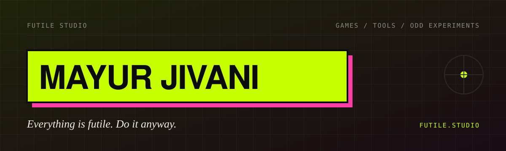</a>

  <b>I build things that probably didn't need to exist, until they did.</b>

Hi, I'm Mayur. I make small games, tools and odd experiments, mostly for the people I play games with.
I love hosting game nights, and a lot of what's here started at one: a quiz that needed a buzzer,
a karaoke night with no machine, a social deduction game with no cards on hand.
Everything runs on a server in my flat. I'm doing my M.Sc. Computer Science at Paderborn.

  <a href="https://futile.studio"><b>futile.studio</b></a> &nbsp;/&nbsp;
  <a href="https://lab.futile.studio"><b>lab.futile.studio</b></a> &nbsp;/&nbsp;
  <a href="https://linkedin.com/in/mayurjivani">LinkedIn</a> &nbsp;/&nbsp;
  <a href="mailto:mayur@futile.studio">mayur@futile.studio</a>

---

## The catalogue

Everything listed on [futile.studio](https://futile.studio). Every screenshot is the running product, and every link goes to it.

### Party games for one TV and a room of phones

<table>
<tr>
<td width="50%" valign="top">
<a href="https://noggin.futile.studio">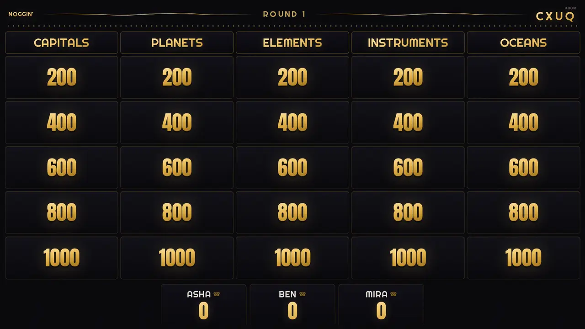</a>
 <b>Noggin'</b> &nbsp;<code>FS-002</code> &nbsp;live
 A quiz show for the TV. Picture, audio and video clues, and a real buzzer race on every phone.
 Astro · React · WebSockets
 <a href="https://noggin.futile.studio">Play</a> · <a href="https://github.com/MayurJivani/Noggin">Source</a>
</td>
<td width="50%" valign="top">
<a href="https://croon.futile.studio">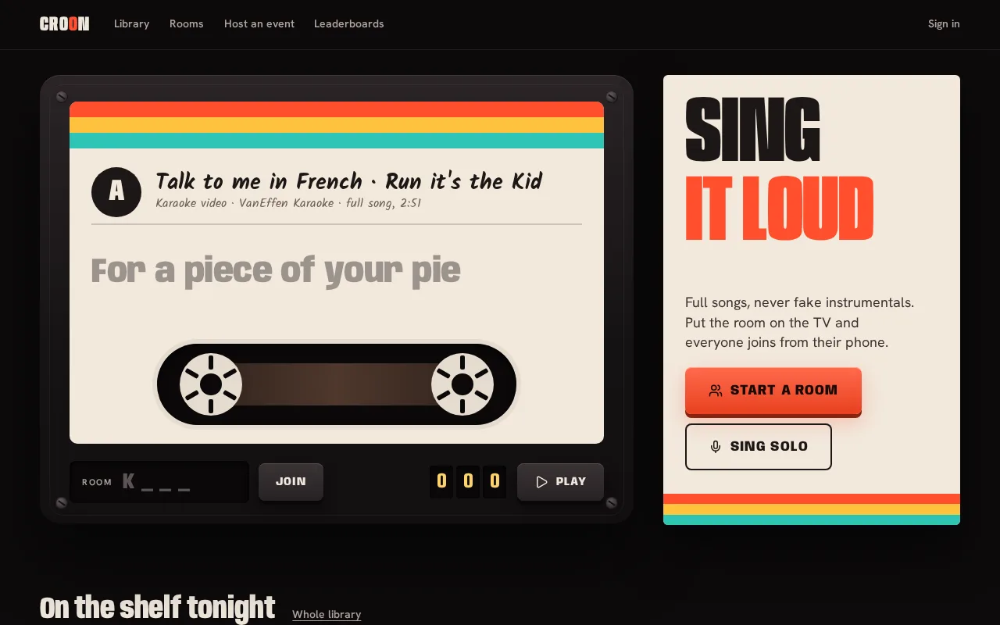</a>
 <b>Croon</b> &nbsp;<code>FS-004</code> &nbsp;live
 Karaoke in the browser. The TV is the stage, your phone is the mic, and the queue rotates so everyone sings.
 React 19 · Node · Socket.IO · Postgres
 <a href="https://croon.futile.studio">Sing</a> · <a href="https://github.com/MayurJivani/Croon">Source</a>
</td>
</tr>
<tr>
<td width="50%" valign="top">
<a href="https://haggle.futile.studio">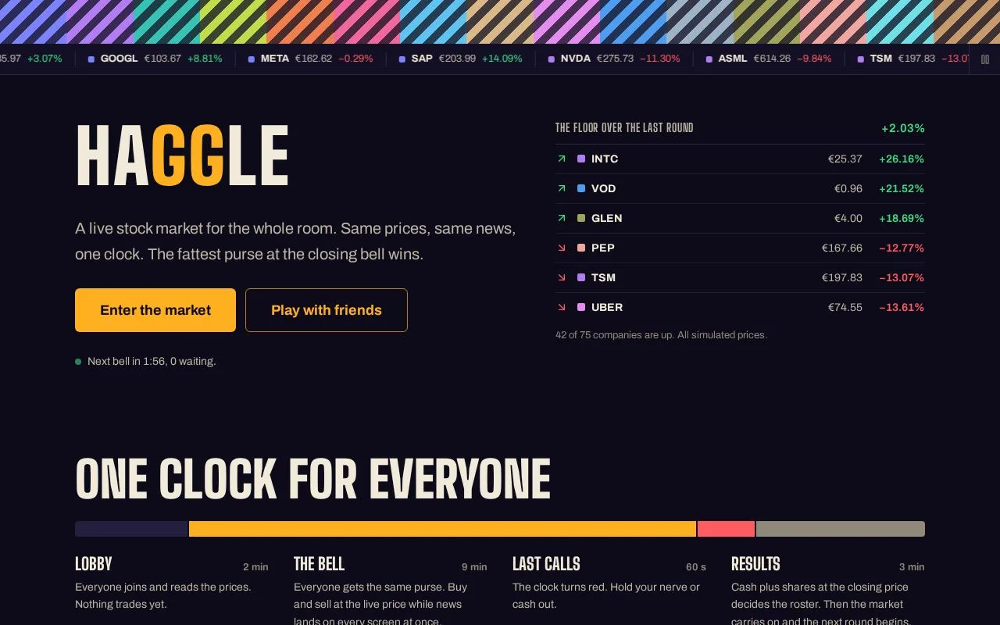</a>
 <b>Haggle</b> &nbsp;<code>FS-003</code> &nbsp;live
 A stock market for the whole room. 500 players, 75 real companies, simulated prices, one opening bell.
 React · Vite · Express · WebSockets · Postgres
 <a href="https://haggle.futile.studio">Play</a> · <a href="https://github.com/MayurJivani/Haggle">Source</a>
</td>
<td width="50%" valign="top">
<a href="https://chorusify.com">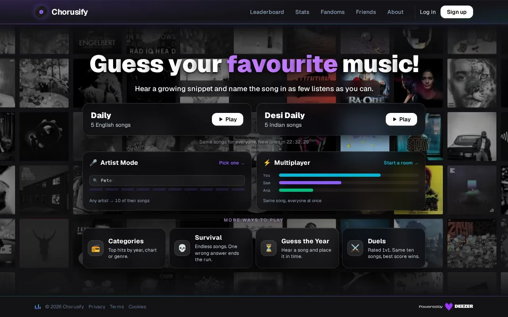</a>
 <b>Chorusify</b> &nbsp;<code>FS-001</code> &nbsp;live
 Guess the song from one second of it. The clip grows with every wrong guess. Daily puzzle, artist runs, duels.
 React 18 · TypeScript · Express · Postgres · Deezer
 <a href="https://chorusify.com">Play</a> · <a href="https://github.com/MayurJivani/Chorusify">Source</a>
</td>
</tr>
</table>

### Table games, played online

<table>
<tr>
<td width="50%" valign="top">
<a href="https://avalon.futile.studio">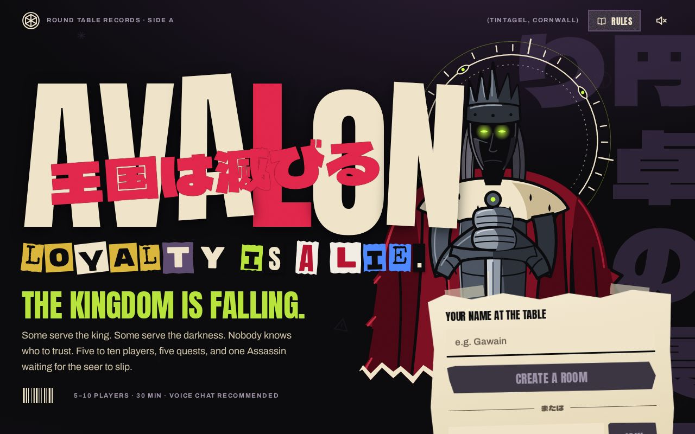</a>
 <b>Avalon</b> &nbsp;live
 Social deduction for 5 to 10 players. Go on quests, vote on teams, trust nobody.
 React 19 · Express · Socket.IO · Zustand
 <a href="https://avalon.futile.studio">Play</a> · <a href="https://github.com/MayurJivani/avalon">Source</a>
</td>
<td width="50%" valign="top">
<a href="https://curio.futile.studio">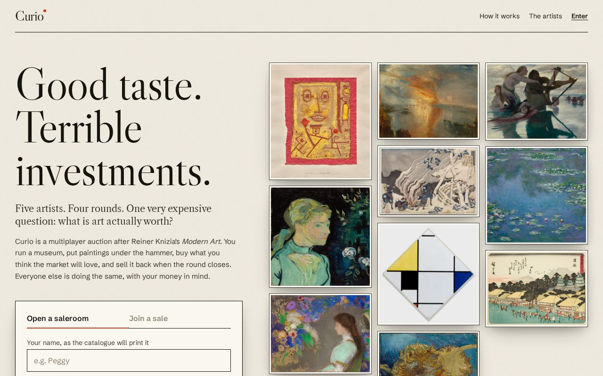</a>
 <b>Curio</b> &nbsp;live
 Good taste, terrible investments. An art auction for 3 to 5 players with real public-domain museum paintings.
 React 19 · Express · Socket.IO
 <a href="https://curio.futile.studio">Play</a> · <a href="https://github.com/MayurJivani/curio">Source</a>
</td>
</tr>
<tr>
<td width="50%" valign="top">
<a href="https://bleep.futile.studio">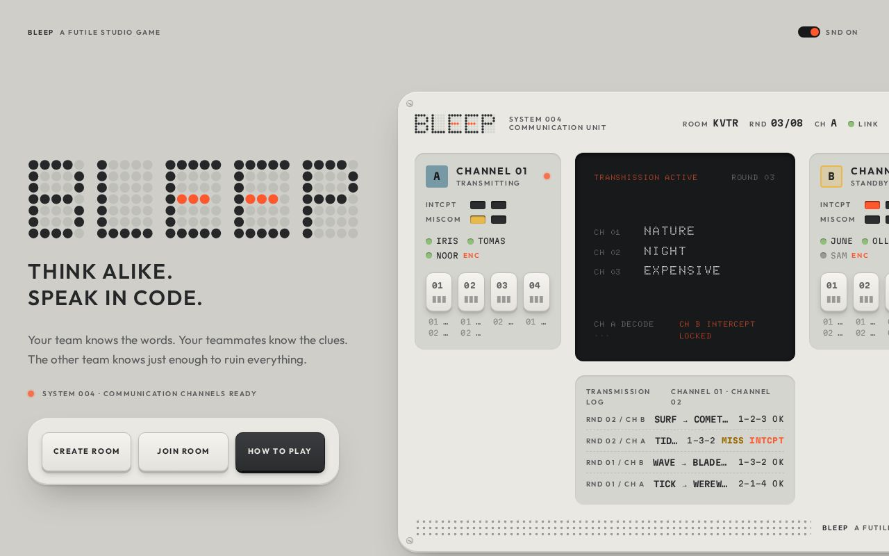</a>
 <b>Bleep</b> &nbsp;live
 Think alike, speak in code. A multiplayer word-deduction game.
 React 19 · Express · Socket.IO
 <a href="https://bleep.futile.studio">Play</a> · <a href="https://github.com/MayurJivani/Bleep">Source</a>
</td>
<td width="50%" valign="top">
<a href="https://hunch.futile.studio">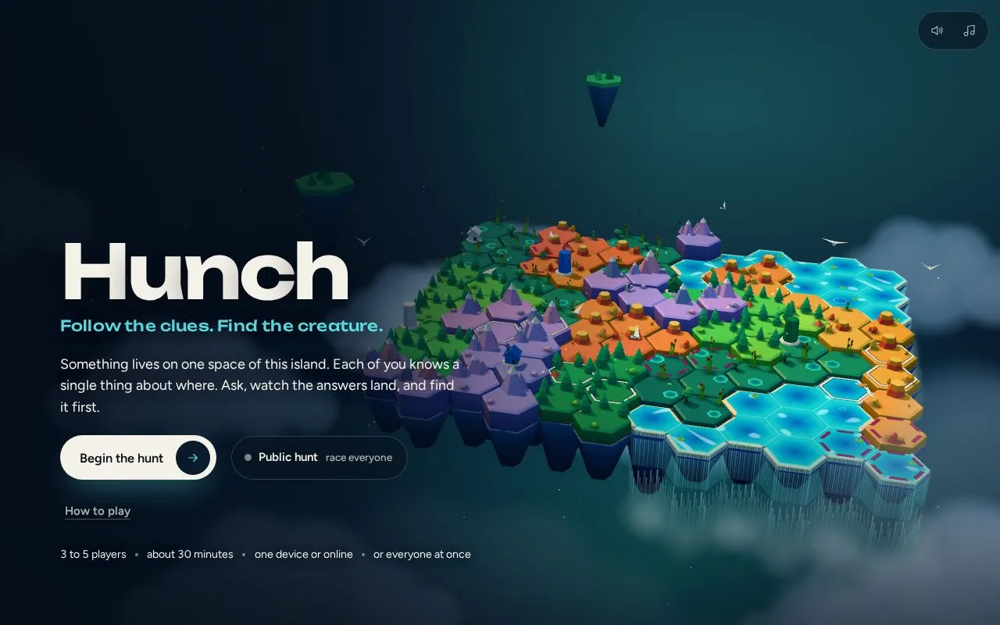</a>
 <b>Hunch</b> &nbsp;<code>FS-005</code> &nbsp;live
 A 3D deduction game for 3 to 5 players. Each of you knows one thing about where the creature lives.
 React · three.js · Socket.IO
 <a href="https://hunch.futile.studio">Play</a> · <a href="https://github.com/MayurJivani/Hunch">Source</a>
</td>
</tr>
</table>

### Tools and experiments

<table>
<tr>
<td width="50%" valign="top">
<a href="https://mosaic.futile.studio">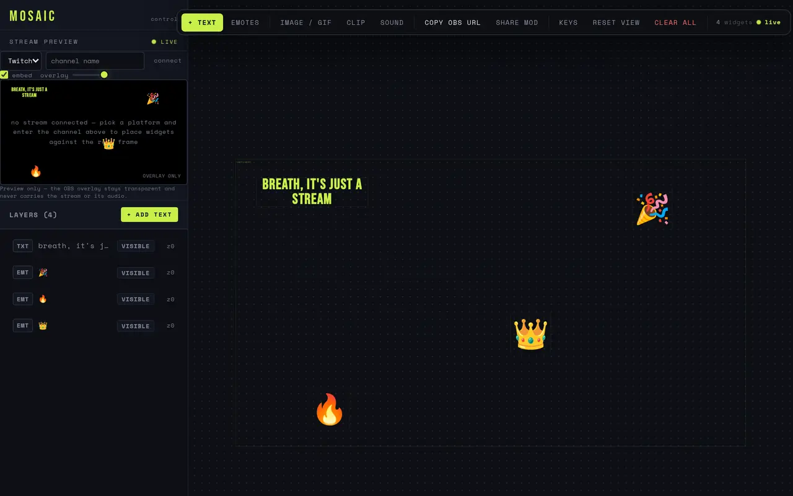</a>
 <b>Mosaic</b> &nbsp;<code>FS-007</code> &nbsp;live
 A stream overlay your mods control. They drag emotes, GIFs and sounds onto the stream while you keep playing.
 Astro · React · WebSockets
 <a href="https://mosaic.futile.studio">Open</a> · <a href="https://github.com/MayurJivani/Mosaic">Source</a>
</td>
<td width="50%" valign="top">
<a href="https://knock.futile.studio">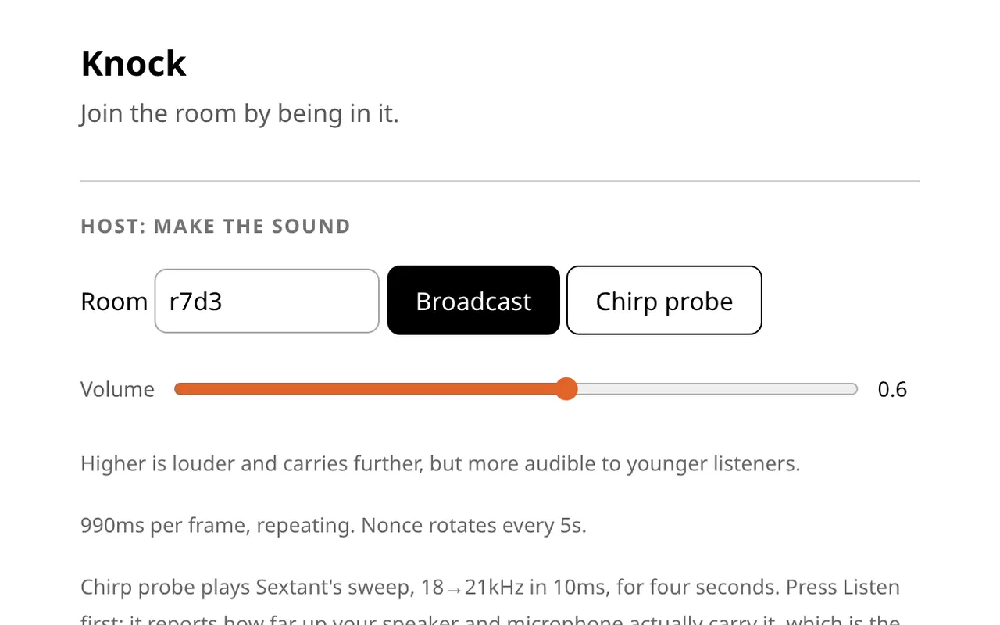</a>
 <b>Knock</b> &nbsp;<code>FS-006</code> &nbsp;live
 Join a room by being in it. A sound too high to hear does the job a QR code usually does.
 Web Audio · vanilla JS
 <a href="https://knock.futile.studio">Try it</a> · source not public yet
</td>
</tr>
<tr>
<td width="50%" valign="top">
<a href="https://patina.futile.studio">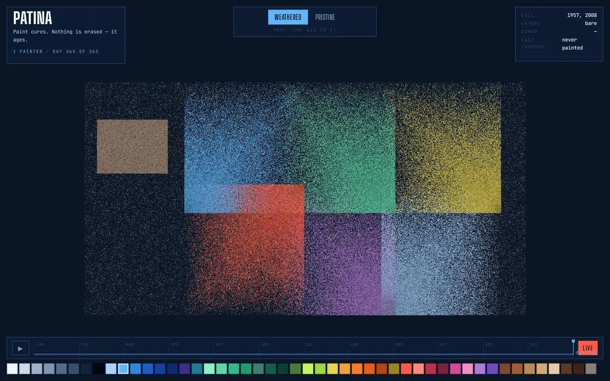</a>
 <b>Patina</b> &nbsp;live
 A 4096×4096 canvas that stays open for a year. Nothing gets painted over: paint ages and cures where it lands.
 Vanilla JS, zero dependencies
 <a href="https://patina.futile.studio">Open</a> · <a href="https://github.com/MayurJivani/Patina">Source</a>
</td>
<td width="50%" valign="top"></td>
</tr>
</table>

---

## The lab

[lab.futile.studio](https://lab.futile.studio) is the messier shelf: prototypes, dailies and things I'm still poking at. Some have public source, some don't yet.

**Games**
- **[Katze](https://katze.futile.studio)** · Skull, themed as Schrödinger's cat. Three live cats, one dead one, lie about it. [Source](https://github.com/MayurJivani/Katze)
- **[Qno](https://qno.futile.studio)** · Uno, except the cards are quantum gates. Superposition is a hand you actually hold. [Source](https://github.com/MayurJivani/Qno-web)
- **[Dealies](https://dealies.futile.studio)** · An underground card club. Hold'em and blackjack with friends, for virtual chips.
- **[Clocktower Table](https://towerbell.futile.studio)** · A community-made Blood on the Clocktower table: the Storyteller's Grimoire, with games run on phones.

**Games for 400 people at once**
- **[Dabber](https://dabber.futile.studio)** · One live match, a different daily game every round, the board goes dark seat by seat.
- **[Pressure](https://pressure.futile.studio)** · One button, one instruction, everyone facing it at the same moment. Do not press.
- **[Consensus](https://consensus.futile.studio)** · Everyone gets the same question. You're not guessing the answer, you're guessing the room.

**Dailies**
- **[Orbitle](https://orbitle.futile.studio)** · Five things a day on one dial, low lunar orbit out past Voyager 1. [Source](https://github.com/MayurJivani/Orbitle)

**Tools and odd ones**
- **[Cubby](https://cubby.futile.studio)** · An encrypted drop box between your own devices. The server stores bytes it can't read. [Source](https://github.com/MayurJivani/Cubby)
- **[Atlas](https://atlas.futile.studio)** · A library for NASA's public image archive, opening on the Artemis II flight release.
- **[Two Rooms & a Boom](https://muddle.futile.studio)** · The party game for 6 to 30 people. One TV, everyone's phone.
- **[WANT / NOT YET](https://gigs.futile.studio)** · Pin what you want, send friends one link, they quietly call dibs.
- **[VICEWIRE](https://vicewire.futile.studio)** · The social network of Vice City. A fan-made parody.
- **Murmur** · One sound field played across whatever phones are lying around. Still in the workshop.

<b>Older work and other repos</b>

 

- **[Shaam](https://github.com/MayurJivani/Shaam)** · Party games for one TV and a room full of phones, with one leaderboard across the night. [Play](https://shaam.futile.studio)
- **[Futile-Studio](https://github.com/MayurJivani/Futile-Studio)** · The source of futile.studio. Astro and GSAP, plus a small Express backend.
- **[Qno (Unity)](https://github.com/MayurJivani/Qno)** · The first Qno, a Unity card game. The web version replaced it.
- **[Chorus-PHP](https://github.com/MayurJivani/Chorus-PHP)** · The original Chorus in PHP and vanilla JS on the Spotify API. Chorusify replaced it.
- **[zenspace](https://github.com/MayurJivani/zenspace)** · Virtual study spaces with a timer, to-do list and custom audio and video players.
- **[Peerly](https://github.com/MayurJivani/Peerly)** · Peer-to-peer file transfer in the browser with React and PeerJS.
- **[Mysic](https://github.com/MayurJivani/Mysic)** · A music app with a React frontend and a Node backend.
- **[FTN-backend](https://github.com/MayurJivani/FTN-backend)** · The Fly The Nest API: Express, S3 uploads, JWT auth.
- **[KemChoAhmdavad-Twitter-Bot](https://github.com/MayurJivani/KemChoAhmdavad-Twitter-Bot)** · A bot that posted Ahmedabad news and events on a schedule.

---

## What I build with

Taken from what's actually in my repos, not a wish list.

**Languages** &nbsp; TypeScript, JavaScript, SQL, Shell. C# for Unity and PHP in older work. 
**Frontend** &nbsp; React, Astro, Vite, Tailwind, three.js, Motion, GSAP, plain ES modules when a build step is overkill. 
**Backend** &nbsp; Node, Express, Socket.IO, ws, Zod. 
**Data** &nbsp; Postgres, Drizzle. 
**Infra** &nbsp; Docker, Caddy, Cloudflare Tunnel, GitHub Actions, a Debian box called Jinx. 
**Also** &nbsp; Web Audio, WebRTC, Vitest, Playwright.

## The back room

Every live project above runs on **Jinx**, a computer in my flat named after the cat.
Cloudflare Tunnel dials out, Caddy reads the hostname and hands the request to the right app,
and the apps that need a real database share one Postgres. Zero ports open to the internet.
At 1am the problem is on this side of the wall, which I like.

## Lately

- **Sound as a network.** Knock joins rooms with ultrasound, Sextant works out where phones are by listening to each other, and Murmur wants to turn all of them into one speaker.
- **One game, hundreds of people.** Dabber, Pressure and Consensus put up to 400 players in the same live match.
- **The TV and phones format.** Noggin, Croon, Shaam and Two Rooms & a Boom all use the TV as the board and every phone as a controller.
- **A turntable you can actually spin**, for the record shelf on futile.studio.

## Activity

  <picture>
    <source media="(prefers-color-scheme: dark)" srcset="https://raw.githubusercontent.com/MayurJivani/MayurJivani/output/snake-dark.svg">
    
  </picture>

  

  

Most of the work lives in repos that aren't public yet, so these numbers undercount it.

## Say hi

Ask me about running a real-time game for a room full of phones and why the server has to be the referee,
about vinyl and cassettes and what gets pressed at Futile Recording Co.,
or about self-hosting and having a server you can walk over to.

  <a href="https://futile.studio">futile.studio</a> &nbsp;/&nbsp;
  <a href="https://lab.futile.studio">lab</a> &nbsp;/&nbsp;
  <a href="https://linkedin.com/in/mayurjivani">LinkedIn</a> &nbsp;/&nbsp;
  <a href="mailto:mayur@futile.studio">mayur@futile.studio</a>

---

<i>We are here briefly. At scale, nothing persists. There is still something worth doing in the making.</i>

